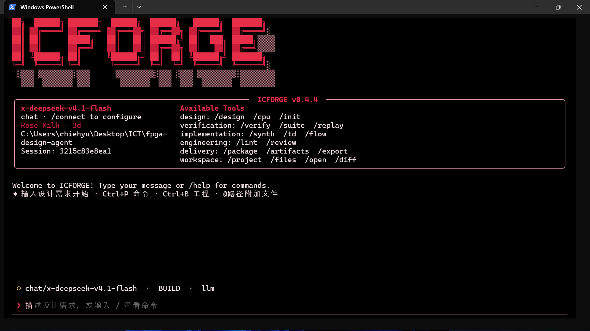
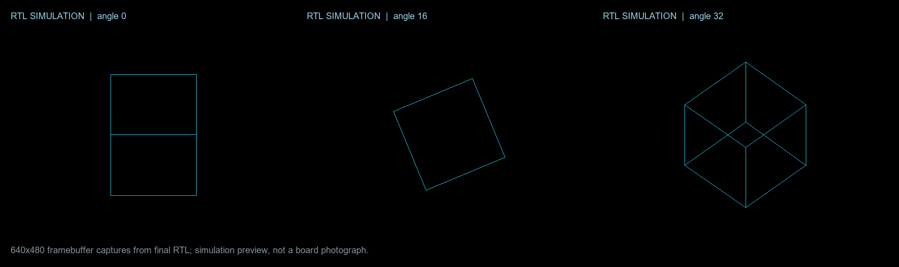

# IC Forge — Digital IC Design Agent

提供终端交互工作台：对话设计、工程切换、实时工具日志、验证证据、文件预览和可恢复会话。Python 3.11+ 安装后直接运行：

```powershell
python -m pip install -e .
icforge
# 或 python -m fpga_agent tui --workspace .
```

安装完成后，可在任意目录运行 `icforge` 启动 TUI；当前目录会作为默认工作区。

## 终端界面



在界面里用 `/connect` 连接模型，`/project` 选择工程，`/verify` 验证，`/flow` 完成实现交付。`Ctrl+P` 命令面板、`Ctrl+O` 文件搜索、`Shift+Tab` 切换 Plan / Build、`Esc` 取消任务。完整操作与迁移说明见 [终端工作台指南](docs/terminal.md)。已有 CLI 命令继续可用。

## 主动任务与长期执行

复杂设计请求默认持续规划并调用工程工具，直到达到验收目标、遇到阻塞或耗尽预算。也可用 `/task 目标` 明确启动后台任务；目标、计划、工作记忆和执行记录持久保存。关闭 TUI 后后台 worker 继续工作，重新进入后用 `/tasks` 查看，`/pause` 暂停，`/continue` 恢复，`/stop` 取消。运行期间可直接追加要求。

```powershell
icforge task start '完成当前 CPU 的验证、FPGA 实现和交付' --project benchmarks/rv32_multi --max-steps 64 --max-hours 24
icforge task status
icforge task logs
```

`/auto off` 切回单次工具模式。暂停/异常恢复会重新检查工程证据；每个工作区只允许一个持续任务。使用方式、验收门槛和测试边界见 [主动任务指南](docs/autonomous-tasks.md)。

第二轮加入 `/skills` 技能发现、`/recall` 历史任务检索和 `/context` 上下文预算展示。支持直接发现 OpenCode、Claude、Command Code、Hermes 及 `.agents/skills` 的本地技能；planner 可按需读取完整源码、技能引用与归档日志。详见 [技能与上下文](docs/knowledge-context.md) 和 [开源 agent 对照与改进](docs/agent-comparison.md)。

用于逐步积累数字 IC 设计能力的本地 agent。当前已实现模型生成/修复、独立 RISC-V 指令级验证、Anlogic TD 综合与布局布线、时序/产物验收和交付归档。

本轮由 **gpt-6-luna** 生成了单周期、多周期、两级流水线三份 RV32I CPU。每份通过 114 个程序、18,099 条指令提交比对、片上 ROM/RAM 签名测试和 50 MHz TD 实现。实测表格见 [riscv-results.md](docs/riscv-results.md)，接口和覆盖范围见 [riscv-flow.md](docs/riscv-flow.md)。

## 指挥外部 Agent

新增 `orchestrate` 模式：IC Forge 负责规划、分工、依赖协调和宿主验收，调用本机 Codex、Claude Code、OpenCode 的非交互 CLI。简单任务可交给一个执行者；独立模块可并行实现，审查等待实现完成，共用文件自动串行。分工在隔离 Git worktree 中执行，限定范围的变更通过检查后导入工作区。

```text
/provider codex
/model native
/mode orchestrate
/agents 2 codex
/orchestrate --workspace 实现两个独立模块，安排审查，并通过现有测试
/agents
```

主管模型和执行者分别配置；`native` 使用本机 Codex 的模型配置与登录。进入编排模式后直接输入目标即可启动持久任务，支持 `/pause`、`/continue` 和追加要求。工作区须为有提交记录的 Git 仓库；通用工程应预先声明验收命令。完整配置、混用多个 CLI、恢复规则及实测范围见 [Agent 编排指南](docs/orchestration.md)。

可用 `/agent-model opencode opencode/deepseek-v4.1-flash-free` 给执行者选择免费模型，`/agent-model claude x-deepseek-v4.1-flash` 给 Claude Code 选择已配置网关的 DeepSeek。Windows 新版 Claude Code 原生程序识别与可选 Messages 网关兼容层见 [多 CLI 联动](docs/backend-linkage.md)。

## HX1P35A HDMI 3D 立方体

`benchmarks/hdmi_cube` 是一次真实的多 Codex gpt-6-luna 端到端试验：6 个互不重叠的实现分工曾同时运行，之后进行顶层集成、只读审查和宿主独立验收。它在 HX1P35A 上生成 640×480 DVI/TMDS 视频，以双轴旋转、定点投影和双缓冲绘制线框立方体。



最终独立验收通过：时序、TMDS、256 个姿态几何、双缓冲、串行器和顶层视频流全部通过；安路 TD full 产生 PH1P35MDG324 bitstream，setup WNS +7.286 ns、hold WNS +0.073 ns、TNS 均为 0，STA 覆盖率 99.88%，使用 38/108 ERAM。首轮综合发现旧 PLL 原语不支持此器件；执行者根据本机安路资料改用 `PH1P_PHY_PLL_V2` 后复验通过。

```powershell
python benchmarks/hdmi_cube/verification/acceptance.py
python -m fpga_agent package benchmarks/hdmi_cube
```

仿真与 FPGA 实现通过不等于实板视觉验收。本轮尚未下载板卡，HDMI 显示器需连接后再检查实际输出。任务记录、方法和完整限制见 [HDMI 立方体工程试验](docs/hdmi-cube-flow.md)。

## 模型与验证

TinyStories260K 已在 HX1P35A 实板通过完整 CRC、1,536 个 logits 和生成 token 对比。额外三轮板上生成也逐 token 通过独立参考校验（每轮 16 个新 token，以下为达到长度上限时的原始片段）：

- `Once upon a time, a little fox` → “Once upon a time, a little fox named Benny. Benny loved to play with his”
- `A little girl` → “A little girl named Lily went to the park with her mom. She saw a”
- `A small dog` → “A small dog named Spot was a boy who loved to play”

模型、生产固件、SPI/UART 完整 RTL 推理和实板证据流程见 [TinyStories 工程试验](docs/tinystories-flow.md)；逐轮校验记录及超时案例见 [实板故事样本](docs/tinystories-rounds.md)。

- `exchange`：本轮临时模型后端。当前会话的 Luna 子代理生成实际响应，再通过带模型标识的文件导入 agent；请求、响应、指纹和修复记录都保留。
- `api`：OpenAI Responses API，默认模型 `gpt-6-luna`，需要 API Key；`chat` 为显式兼容接口。
- `codex`：可调用独立 Codex CLI。本轮六个并行执行者均显式使用 `gpt-6-luna`，并保留本机 Codex provider 与认证配置；没有切换到 Gemini 或其他模型。
- CPU 生成模型只负责候选 RTL。Python 参考模型、testbench、定向/随机程序和验收规则由验证侧持有，模型不能通过修改 testbench 降低门槛。

普通模块仍可用 `design` 生成 RTL 和自检 testbench；CPU profile 通过 `cpu-design` 使用独立参考验证。后续 FIFO、算术、总线和存储控制等能力可以沿用 provider、验证 profile、TD 和证据门禁。

## 环境

Python 3.11+，TUI 使用 Textual（安装时自动获取）；Icarus Verilog 12+；Anlogic TD 6.2.x。当前本机 Icarus 位于 `.tools/icarus`，工具二进制不打入源码交付包。

```powershell
winget install --id Icarus.Verilog --exact
python -m pip install -e .
$env:ANLOGIC_TD_ROOT = 'C:\Anlogic\TD_6.2.1_Engineer_6.2.168.116'
```

也可直接在工程根目录使用 `python -m fpga_agent`。

## 重现三份 CPU

```powershell
# 使用保存的真实 Luna 响应，重新导入、仿真、实现和打包
python -m fpga_agent cpu-design benchmarks/rv32_single --architecture single --provider exchange --response-file benchmarks/rv32_single/generation/luna-response.json --full
python -m fpga_agent cpu-design benchmarks/rv32_multi --architecture multi --provider exchange --response-file benchmarks/rv32_multi/generation/luna-response.json --full
python -m fpga_agent cpu-design benchmarks/rv32_pipeline --architecture pipeline --provider exchange --response-file benchmarks/rv32_pipeline/generation/luna-response.json --full

# 只重跑独立回归；加 --full 会重新运行 TD 和交付
python -m fpga_agent cpu-suite
python -m fpga_agent cpu-suite --full
python scripts/report_suite.py
```

新设计接入在线模型时：

```powershell
$env:OPENAI_API_KEY = '你的 Key'
python -m fpga_agent cpu-design my-cpu --architecture multi --provider api --model gpt-6-luna --full
```

API Key 只从环境变量读取，不写入请求审计文件。exchange 只重放指定文件中的模型响应；失败后会落下一轮修复请求，需要提供新的模型响应。

## 普通 RTL 流程

```powershell
python -m fpga_agent init my-design
python -m fpga_agent design my-design --brief-file requirements.md --provider api --model gpt-6-luna
python -m fpga_agent flow my-design
```

`flow` 执行验证、TD full 和默认交付。`package` 必须有当前输入对应的完整实现证据；仅交付仿真材料需显式加 `--simulation-only`。RTL、testbench、参考模型、板卡/时序约束变化及 bitstream 被修改，都有对应证据检查。

## 交付内容与边界

工程严谨性增强：新增 `/lint`、`/review`，按规格、RTL、验证、实现、集成职责生成可追溯检查与下一步动作。普通 RTL 修复冻结已接受的验证器；新工程按需求 ID 检查运行结果；仿真指纹覆盖规格、配置、include 和 ROM 数据；交付包附工程审查与逐文件 SHA-256。缺少工具、人工审阅或未执行分析会明确保留。使用与迁移说明见 [工程审查流程](docs/engineering-workflow.md)。

当前源码版本为 0.6.0；此前公开发布的 [v0.4.3](https://github.com/Wooohaaa/digital-ic-design-agent/releases/tag/v0.4.3) 提供九套可切换终端主题和四种字符字标，支持通过 `/theme`、`/logo` 即时切换并按工作区保存。界面保持纯黑背景，只切换文字、字标、光标和线框颜色；包含参考图中的 Rose/Citrine 配色，以及 Nord、Tokyo Night、Catppuccin 等现代色板。工程门禁实测结果及未关闭检查见 [工程流程验收](docs/engineering-validation.md)。历史版本保留用于复现。

归档内的三份工程分别在 `benchmarks/rv32_*/deliverables/`，包含 RTL、独立 testbench、约束、可移动 TD `.al` 工程、bitstream、时序/资源报告和验证记录。综合测试封装含片上 ROM/RAM 和提交签名序列化输出。

本轮是 RV32I 整数执行核及 FPGA 实现，不含 CSR/特权模式/中断、M/C 扩展或 ASIC 物理签核。尚未运行 Spike/官方架构测试/形式证明，也没有下载开发板。时钟 C4、复位 R10、screen PWM R11 来自公开 HX1P35A 工程，实际编程前按板卡 revision 与官方原理图核对。

参考：[RSI-Chip](https://github.com/RSI-Labs/RSI-Chip)、[PicoRV32](https://github.com/YosysHQ/picorv32)、[Ibex](https://github.com/lowRISC/ibex) 及 [RISC-V 官方 RV32I 规范](https://docs.riscv.org/reference/isa/v20260120/unpriv/rv32.html)。来源和借鉴范围见 [references.md](docs/references.md)。
