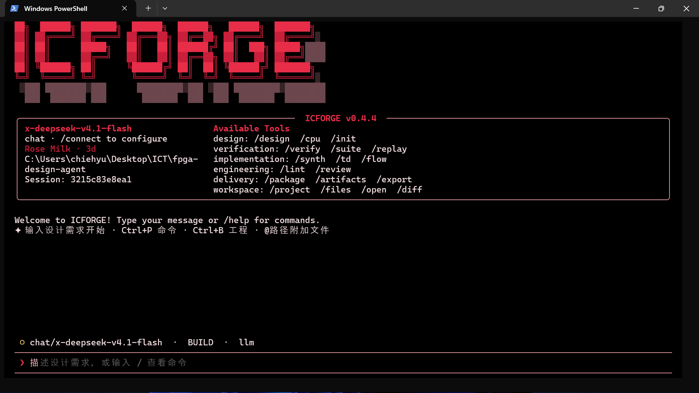

# IC Forge

IC Forge 是面向数字 IC/FPGA 工程的终端 agent：从需求、RTL 生成与修复，到仿真、lint、安路 TD 实现、证据审查和交付归档。它也能把有明确文件范围的工作交给本机 Codex、Claude Code 或 OpenCode，再由宿主工程门禁验收。

## 快速开始

需要 Python 3.11 或更高版本。安装后可以从任意终端目录运行 `icforge`；当前目录会作为默认工作区。

```powershell
python -m pip install -e .
icforge
```

首次进入后，使用 `/connect` 配置模型，`/project` 选择或创建工程。终端命令和迁移说明见[工作台指南](docs/terminal.md)。



### 本地 FPGA 工具

只用 Python 和仿真时不需要 Anlogic TD。完整 HX1P35A 流程还需要 Icarus Verilog 12+、Verilator 5+ 和 Anlogic TD 6.2.x。TD 是 Windows 专用工具，当前版本没有在 GitHub 托管 runner 上运行。

```powershell
python -m pip install -e ".[test]"
$env:ANLOGIC_TD_ROOT = 'C:\Anlogic\TD_6.2.1_Engineer_6.2.168.116'
icforge --help
```

可选的 `icforge lec`/`icforge formal`/`icforge synth` 只依赖 Yosys：安装 `python -m pip install -e ".[formal]"` 会带上可移植的 `yowasp-yosys`，或使用 PATH 上的原生 `yosys`，或用 `ICFORGE_YOSYS` 指定。它们与厂商工具解耦，因此不安装安路 TD 也能运行。可选的 `icforge svsim` 用 Verilator `--binary` 运行最小 class 化（UVM 风格）验证环境，需要 Verilator 加 C++ 编译器与 make，缺少时明确报 `blocked`；细节见 [最小 class 化验证环境](docs/svsim.md)。可选的 `icforge implement PROJECT --target lattice-ice40-hx1k` 走厂商中立的多后端实现层：安装 `python -m pip install -e ".[openfpga]"` 会带上开放 iCE40 流（Yosys `synth_ice40` → nextpnr-ice40 → icepack），或使用 PATH 上的原生可执行文件，或用 `ICFORGE_NEXTPNR`/`ICFORGE_ICEPACK` 指定；工具缺失时明确报 `blocked`，细节见 [厂商中立实现后端](docs/backends.md)。`icforge targets` 列出内置目标 profile。

## 一条常用流程

```powershell
icforge init my-design
icforge design my-design --brief-file requirements.md --provider api --model gpt-6-luna
icforge verify my-design
icforge lint my-design
icforge review my-design
icforge flow my-design
```

`flow` 会在当前验证证据有效时运行 TD 实现并打包。没有工具或未关闭的人工审查会作为明确状态保留；`artifact_ready` 不等于工程签核。详细门禁见[工程审查流程](docs/engineering-workflow.md)。

普通 Icarus testbench 通过后，可用 `icforge mutation-audit PROJECT` 抽样注入 RTL 运算符错误，量化 testbench 检错能力；命令在临时副本运行，不改工程源文件。长期任务的成功率、失败工具和耗时可用 `icforge task metrics` 汇总。

需要更强证据时：`icforge lec PROJECT` 用 Yosys 做逻辑等价证明，`icforge formal PROJECT` 做有界/归纳属性检查，`icforge synth PROJECT` 把 RTL 降到**厂商中立的技术无关门级网表**并报告单元/触发器资源——三者都不依赖安路 TD，缺少 Yosys 时明确报 `blocked`，不假装成功。RTL 与 testbench 可以是 `.v` 或 `.sv`，支持的 SystemVerilog 构造范围见 [SystemVerilog 支持范围](docs/systemverilog.md)。需要真实位流时，`icforge implement PROJECT --target lattice-ice40-hx1k` 走开放 iCE40 后端把设计综合、布局布线并打包出 `.bin`；它产出的是真实位流但**不是**实板通过，细节见 [厂商中立实现后端](docs/backends.md)。需要 RTL 结构覆盖率时，`icforge coverage PROJECT` 用 Verilator `--binary --coverage` 构建并运行自检 testbench，解析 SystemC 的 `coverage.dat` 得到 line/branch/toggle/expr 结构覆盖并写入 `reports/coverage.json`；它测的是**结构**覆盖（不是功能覆盖），工具缺失时明确报 `blocked`，细节见 [RTL 结构与功能覆盖率](docs/coverage.md)。需要功能/断言覆盖时，`icforge coverage PROJECT --functional-coverage` 额外收集 `cover property` 功能点并检查 `assert property` 是否违例（违例即 `fail`），与结构覆盖分开由 `COV-002` 门记录。`icforge cdc PROJECT` 对 RTL 做源码级时钟/复位域交叉结构启发式分析（候选供评审，不是 CDC 形式证明）；`icforge timing PROJECT` 汇总布线后静态时序签核并尝试 post-route 仿真（当前环境无 `icesim` 时如实记 `blocked`）；`icforge release PROJECT --version 0.7.0` 聚合全部门禁并生成版本化交付 zip。细节分别见 [CDC/RDC 分析](docs/cdc.md)、[时序/物理签核路径](docs/timing.md)、[版本化发布](docs/release.md)。

## 工程验证记录

- [当前验证状态与未关闭事项](docs/engineering-validation.md)
- [实验索引与复现入口](docs/experiment-log.md)
- [三种 RV32I CPU 结果](docs/riscv-results.md) · [流程和指令范围](docs/riscv-flow.md)
- [HX1P35A HDMI 立方体实板记录](docs/hdmi-cube-flow.md)
- [TinyStories260K 实板推理记录](docs/tinystories-flow.md)
- [Agent 并行调度回归夹具](docs/agent-validation-roadmap.md)
- [RSI-Chip 七阶段路线图 → icforge 映射](ROADMAP.md)
- [RTL mutation audit](docs/rtl-mutation-audit.md) · [Agent 任务评估](docs/agent-evaluation.md)
- [形式验证与 LEC](docs/formal.md) · [厂商中立综合](docs/synth.md) · [SystemVerilog 支持范围](docs/systemverilog.md) · [最小 class 化验证环境](docs/svsim.md) · [厂商中立实现后端](docs/backends.md) · [RTL 结构与功能覆盖率](docs/coverage.md) · [CDC/RDC 分析](docs/cdc.md) · [时序/物理签核路径](docs/timing.md) · [版本化发布](docs/release.md)

## 开发与 CI

```powershell
uv sync --locked --all-extras
uv run --locked --all-extras --python 3.11 pytest --cov=fpga_agent --cov-report=term-missing
```

GitHub Actions 覆盖 Python 3.11/3.12 与 Windows/Linux，并在 Linux 作业安装 Icarus 和 Verilator，运行自检 RTL 夹具（含 SystemVerilog、class 化环境）、开放 iCE40 实现、RTL 结构/功能覆盖、CDC 分析、时序与发布聚合。Python 包依赖由 [`uv.lock`](uv.lock) 固定；本地实测 EDA 工具版本和 TD 平台边界见 [`toolchain.json`](toolchain.json)。

## 许可

IC Forge 使用 [MIT License](LICENSE)。
