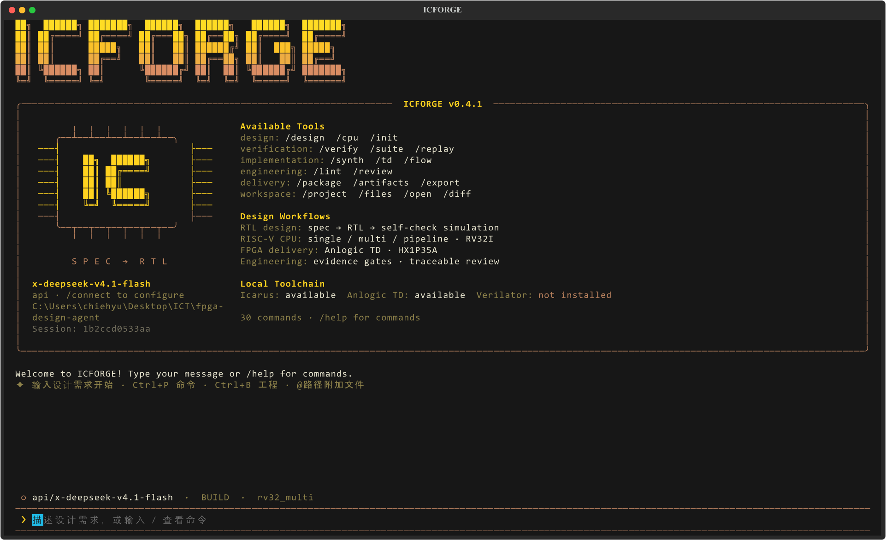

# IC Forge — Digital IC Design Agent

0.3 提供终端交互工作台：对话设计、工程切换、实时工具日志、验证证据、文件预览和可恢复会话。Python 3.11+ 安装后直接运行：

```powershell
python -m pip install -e .
icforge
# 或 python -m fpga_agent tui --workspace .
```

安装完成后，可在任意目录运行 `icforge` 启动 TUI；当前目录会作为默认工作区。



在界面里用 `/connect` 连接模型，`/project` 选择工程，`/verify` 验证，`/flow` 完成实现交付。`Ctrl+P` 命令面板、`Ctrl+O` 文件搜索、`Shift+Tab` 切换 Plan / Build、`Esc` 取消任务。完整操作与迁移说明见 [终端工作台指南](docs/terminal.md)。已有 CLI 命令继续可用。

用于逐步积累数字 IC 设计能力的本地 agent。当前已实现模型生成/修复、独立 RISC-V 指令级验证、Anlogic TD 综合与布局布线、时序/产物验收和交付归档。

本轮由 **gpt-6-luna** 生成了单周期、多周期、两级流水线三份 RV32I CPU。每份通过 114 个程序、18,099 条指令提交比对、片上 ROM/RAM 签名测试和 50 MHz TD 实现。实测表格见 [riscv-results.md](docs/riscv-results.md)，接口和覆盖范围见 [riscv-flow.md](docs/riscv-flow.md)。

## 模型与验证

- `exchange`：本轮临时模型后端。当前会话的 Luna 子代理生成实际响应，再通过带模型标识的文件导入 agent；请求、响应、指纹和修复记录都保留。
- `api`：OpenAI Responses API，默认模型 `gpt-6-luna`，需要 API Key；`chat` 为显式兼容接口。
- `codex`：可调用独立 Codex CLI。本机 ChatGPT 账户对 `gpt-6-luna` 返回 model_not_found，本轮采用会话内 Luna 与 exchange，没有自动改用其它模型。
- CPU 生成模型只负责候选 RTL。Python 参考模型、testbench、定向/随机程序和验收规则由验证侧持有，模型不能通过修改 testbench 降低门槛。

普通模块仍可用 `design` 生成 RTL 和自检 testbench；CPU profile 通过 `cpu-design` 使用独立参考验证。后续 FIFO、算术、总线和存储控制等能力可以沿用 provider、验证 profile、TD 和证据门禁。

## 环境

Python 3.11+，TUI 使用 Textual（安装时自动获取）；Icarus Verilog 12+；Anlogic TD 6.2.x。当前本机 Icarus 位于 `.tools/icarus`，工具二进制不打入源码交付包。

```powershell
winget install --id Icarus.Verilog --exact
python -m pip install -e .
$env:ANLOGIC_TD_ROOT = 'C:\Anlogic\TD_6.2.1_Engineer_6.2.168.116'
```

也可直接在工程根目录使用 `python -m fpga_agent`。

## 重现三份 CPU

```powershell
# 使用保存的真实 Luna 响应，重新导入、仿真、实现和打包
python -m fpga_agent cpu-design benchmarks/rv32_single --architecture single --provider exchange --response-file benchmarks/rv32_single/generation/luna-response.json --full
python -m fpga_agent cpu-design benchmarks/rv32_multi --architecture multi --provider exchange --response-file benchmarks/rv32_multi/generation/luna-response.json --full
python -m fpga_agent cpu-design benchmarks/rv32_pipeline --architecture pipeline --provider exchange --response-file benchmarks/rv32_pipeline/generation/luna-response.json --full

# 只重跑独立回归；加 --full 会重新运行 TD 和交付
python -m fpga_agent cpu-suite
python -m fpga_agent cpu-suite --full
python scripts/report_suite.py
```

新设计接入在线模型时：

```powershell
$env:OPENAI_API_KEY = '你的 Key'
python -m fpga_agent cpu-design my-cpu --architecture multi --provider api --model gpt-6-luna --full
```

API Key 只从环境变量读取，不写入请求审计文件。exchange 只重放指定文件中的模型响应；失败后会落下一轮修复请求，需要提供新的模型响应。

## 普通 RTL 流程

```powershell
python -m fpga_agent init my-design
python -m fpga_agent design my-design --brief-file requirements.md --provider api --model gpt-6-luna
python -m fpga_agent flow my-design
```

`flow` 执行验证、TD full 和默认交付。`package` 必须有当前输入对应的完整实现证据；仅交付仿真材料需显式加 `--simulation-only`。RTL、testbench、参考模型、板卡/时序约束变化及 bitstream 被修改，都有对应证据检查。

## 交付内容与边界

工程严谨性增强：新增 `/lint`、`/review`，按规格、RTL、验证、实现、集成职责生成可追溯检查与下一步动作。普通 RTL 修复冻结已接受的验证器；新工程按需求 ID 检查运行结果；仿真指纹覆盖规格、配置、include 和 ROM 数据；交付包附工程审查与逐文件 SHA-256。缺少工具、人工审阅或未执行分析会明确保留。使用与迁移说明见 [工程审查流程](docs/engineering-workflow.md)。

当前工程门禁版本为 [v0.4.0](https://github.com/Wooohaaa/digital-ic-design-agent/releases/tag/v0.4.0)，发布包包含 TUI、安装 wheel、四份工程交付包和本轮验证记录。实测结果及未关闭检查见 [工程流程验收](docs/engineering-validation.md)。历史 0.3/0.2 材料保留用于复现。

归档内的三份工程分别在 `benchmarks/rv32_*/deliverables/`，包含 RTL、独立 testbench、约束、可移动 TD `.al` 工程、bitstream、时序/资源报告和验证记录。综合测试封装含片上 ROM/RAM 和提交签名序列化输出。

本轮是 RV32I 整数执行核及 FPGA 实现，不含 CSR/特权模式/中断、M/C 扩展或 ASIC 物理签核。尚未运行 Spike/官方架构测试/形式证明，也没有下载开发板。时钟 C4、复位 R10、screen PWM R11 来自公开 HX1P35A 工程，实际编程前按板卡 revision 与官方原理图核对。

参考：[RSI-Chip](https://github.com/RSI-Labs/RSI-Chip)、[PicoRV32](https://github.com/YosysHQ/picorv32)、[Ibex](https://github.com/lowRISC/ibex) 及 [RISC-V 官方 RV32I 规范](https://docs.riscv.org/reference/isa/v20260120/unpriv/rv32.html)。来源和借鉴范围见 [references.md](docs/references.md)。
