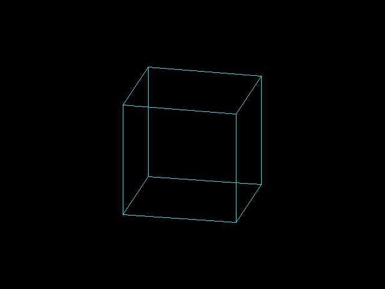
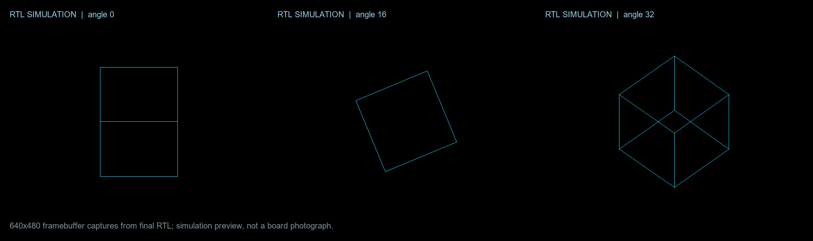

# HX1P35A HDMI rotating cube

This project renders a rotating 3-D wireframe cube to the HX1P35A HDMI connector using 640x480 DVI-compatible TMDS video. Geometry rotates on both axes; two on-chip one-bit buffers keep the displayed frame stable while the back buffer is cleared and redrawn.

## Board I/O

The HDMI data and forwarded-clock outputs use the board's HR bank 32 TMDS33 pads. The top-level
drives one P-side signal per lane; TD infers the paired N pad from the TMDS33 assignment:

| Signal | FPGA pins |
| --- | --- |
| TMDS data lane 0 (blue) | G16 / H16 |
| TMDS data lane 1 (green) | F17 / E18 |
| TMDS data lane 2 (red) | H14 / H13 |
| TMDS clock | C17 / D18 |
| 50 MHz reference clock | C4 |
| Board HDMI_HPD signal (left unassigned) | B17 |

The supplied Anlogic reference design leaves B17 unassigned. IC Forge also leaves it undriven;
an earlier test that drove B17 high was not detected by the capture card. DDC remains unconnected.

## Physical board capture

The following animation is a real Hagibis capture from the HX1P35A, after receiver lock.
It is not an RTL simulation or generated mockup.



The qualified default background is near-black RGB=(1,1,1). Extended RGB=(0,0,0)
failed to lock on this board/receiver chain. `BACKGROUND_LEVEL=0` remains selectable,
but is **not hardware-qualified here**. The electrical or receiver-specific reason
for that data-pattern sensitivity has not been established. This is a documented
compatibility setting, not a claim that strict-black TMDS is inherently invalid.

## RTL simulation preview

The image below contains three actual 640×480 framebuffer captures generated from the final RTL at different rotation angles. It is a simulation preview, not a photograph or visual verification of the physical board.



## Clocks and alignment

The PH1P35 uses `PH1P_PHY_PLL_V2` with external feedback through a BUFG, following the supplied Anlogic example's topology and loop settings. Output C0 is 50 MHz for feedback; C4 and C5 use dividers 50 and 10 to produce 25 MHz pixel and 125 MHz serializer clocks. TD cannot derive clock parameters from this primitive, so SDC constrains both PLL outputs explicitly (`/2` and `×2.5`), preserving the intended 5:1 ratio. The 25 MHz mode yields 640×480 at about 59.52 Hz. Only the asynchronous reset request path is excluded from setup/recovery analysis. Four `PH1P_LOGIC_ODDR` lanes serialize blue, green, red, and the forwarded 50% pixel clock; each ODDR drives its TMDS33 P-side top-level pin, with TD pairing the N pad as shown in the vendor reference layout report.

The framebuffer read is synchronous and contributes one pixel of latency. The DE, HSYNC, and VSYNC control inputs are delayed by one pixel before the single-register TMDS encoders, aligning control symbols with the sampled framebuffer pixel. Blue carries HSYNC/VSYNC during blanking; red and green use control code 00.

## Acceptance result

On 2026-11-05 the current RTL passed independent raster, exhaustive/random TMDS,
256-pose geometry, double-buffer rendering, full top-level RGB recovery, and
synthesizable ODDR-branch checks across 16 clock-phase cases with staggered input
bit delays. The functional ODDR model uses documented d0/rising and d1/falling
semantics; it does not claim vendor timing simulation.

Native Anlogic TD 6.2.168.116 full closed setup WNS **+5.746 ns**, hold WNS
**+0.066 ns**, both TNS **0**, and STA coverage **99.99%**. Resource use is
847/21,216 LUT6, 38/108 ERAM, 4/40 DSP and 9 pads. Unused DRP/dynamic phase clock
inputs are tied low, matching the supplied generated Anlogic example.

Two separate SRAM downloads and physical capture trials passed: **18/18** accepted
samples after a 5-second settling interval in the first 14-second capture, and
**30/30** in a fresh 20-second capture. Each sample was compared against independent
cube geometry; multiple changing pose groups were required. Black screens,
No Signal, bars and static images are rejected. Flash was not written.

Qualified bitstream SHA-256:
`8a91ebb24042e39ec3d17c9442c25864391914f8ec6232cd021def545b698431`

- Stable local image: `deliverables/hdmi_cube-hx1p35a.bit`.
- Delivery archive: `deliverables/hdmi_cube-delivery.zip` (contains the exact implemented
  image, RTL, native timing reports, payload-bound programming evidence and raw video).
- Physical evidence: `reports/hardware-video.json`; trial summary is also available
  in [docs/hdmi-cube-hardware.json](../../docs/hdmi-cube-hardware.json).
- Local MP4: `deliverables/hdmi_cube-hardware.mp4`.

```powershell
# Complete host verification and native implementation
python benchmarks/hdmi_cube/verification/acceptance.py
# Explicit SRAM programming, receiver settling, capture and reference checking
icforge video-hardware benchmarks/hdmi_cube --program --device Hagibis
# Or perform the entire flow including physical acceptance and packaging
icforge flow benchmarks/hdmi_cube --hardware-video --device Hagibis
```

`hardware_acceptance.required=true` makes a missing/stale/failed physical report
block FPGA delivery and persistent task completion. SVF success checks identity
and scan execution; configuration readback is not claimed. The programmed scan
payload is compared byte-for-byte with the validated .bit binary body. Hardware
operations use an OS-held exclusive lease across programming and capture.

## Checks

Supplemental Icarus testbench commands are listed in `tb/README.md`. The operator-owned `verification/acceptance.py` performs the independent HDMI-cube acceptance, including native TD checks. Physical programming and display verification are performed by the host and are not implied by these sources.
