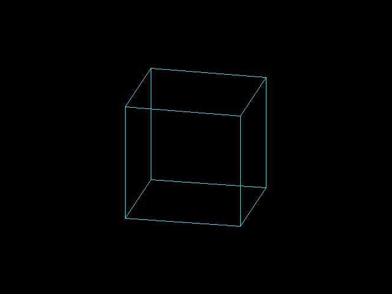

# 实验记录索引

本页集中索引可复现的工程结果。数字来自各工程保存的测试报告、实现报告或板上记录；CPU 的折算 MIPS 不是 CoreMark，SRAM 配置成功也不代表功能观察已闭合。

## RISC-V CPU

单周期、多周期和两级流水线 RV32I 使用同一套 114 个程序、64 个确定性随机种子和独立指令参考模型。记录包含退休指令、仿真周期、TD 资源/时序、下载方式和限制：

- [性能与 HX1P35A 下载记录](riscv-results.md)
- [CPU 验证流程和当前 ISA 边界](riscv-flow.md)

该基准是固定仿真工作集，不是标准性能认证。已完成 SRAM-only JTAG 配置；R11 串行签名未采集，因此板上功能分数仍以 RTL 回归为依据。正式架构测试和形式验证尚未接入。

## HDMI 旋转立方体

HX1P35A HDMI 设计做过两次独立 SRAM 下载及采集卡验收，详见[实板试验记录](hdmi-cube-flow.md)和[结构化证据](hdmi-cube-hardware.json)。

## TinyStories260K

该试验在 HX1P35A 上运行 260K TinyStories 模型，检查完整模型 CRC、logits 和生成 token。复现步骤、固件/RTL 边界及逐轮样本见[TinyStories 流程](tinystories-flow.md)、[实板轮次](tinystories-rounds.md)和[机器结果](tinystories-results.json)。

## Agent 调度和验证夹具

`sync_fifo`、`spi_master`、`apb_pwm_timer` 夹具用于检验多 agent 分工、可信 testbench、Icarus 仿真和 Verilator lint。它们不声明板级时序签核；当前门禁与执行命令见[验证路线图](agent-validation-roadmap.md)。
